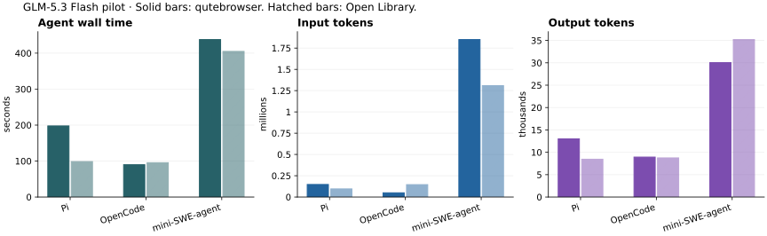

# HarnessTwin Hard technical report

26 November 2026 · Himanshu Kumar

This experiment measures how the harness changes task resolution, tool use, runtime and token use when model serving, tasks and resource budgets are held fixed. The pilot uses `zai-org/GLM-5.3-Flash` through GMI Cloud. The authenticated inventory also returned `zai-org/GLM-5.3`, both DeepSeek V4.1 Flash identifiers in the saved inventory, and `moonshotai/kimi-k3`.

[Authenticated inventory](https://github.com/himanshu748/harnesstwin-hard/actions/runs/45747559909) · [Serving IDs](evidence/inventory.json)

## Six-run Flash pilot

mini-SWE-agent resolved the qutebrowser task. Its 17,293-byte patch modified the Qt key-handling code and its tests. The fresh official verifier passed all 1,869 required tests. The other five attempts left empty patches and received reward `0`.

| Task | Harness | Official reward | Agent time (s) | Model calls | Requested tools | Input tokens | Output tokens | Reasoning tokens |
| --- | --- | ---: | ---: | ---: | ---: | ---: | ---: | ---: |
| qutebrowser | Pi | 0 | 197.64 | 10 | 14 | 147,214 | 13,004 | 12,297 |
| qutebrowser | OpenCode | 0 | 89.89 | 4 | 4 | 49,720 | 8,930 | 8,815 |
| qutebrowser | mini-SWE-agent | 1 | 437.85 | 40 | 44 | 1,850,489 | 30,048 | 22,368 |
| Open Library | Pi | 0 | 98.54 | 6 | 8 | 95,462 | 8,451 | 8,236 |
| Open Library | OpenCode | 0 | 95.45 | 7 | 8 | 145,602 | 8,748 | 8,550 |
| Open Library | mini-SWE-agent | 0 | 404.90 | 34 | 32 | 1,308,785 | 35,211 | 34,002 |

Observed pass@1 was 1/2 for mini-SWE-agent and 0/2 each for Pi and OpenCode. Both paired differences for mini-SWE-agent were +50 percentage points with descriptive 95% task-bootstrap intervals of 0 to 100 points. Pi and OpenCode tied on both tasks. Two convenience-sampled tasks and one trial give weak evidence about a general ranking. The 19-minute budget and 8,192-token completion cap limit comparisons with other published HARD-51 runs.

Both Pi and both OpenCode traces ended on the provider completion limit. On qutebrowser, Pi logged one tool execution error and mini-SWE-agent logged six failed or nonzero shell commands. Both subsequently executed successful tools. mini-SWE-agent used all 40 allowed model calls on qutebrowser and left the passing patch. The official replay reset the test surface before applying the official tests. On Open Library, OpenCode ran a successful tool after one recorded tool failure, and mini-SWE-agent stopped after repeated tool-call format errors. The initial mini-SWE-agent attempt on qutebrowser stopped because LiteLLM had no price entry for the exact GMI model ID. The retry let the relay enforce the same budgets while LiteLLM ignored entry lookup errors. The initial failure is retained in the integration evidence and excluded from pass@1. There were no relay-recorded upstream errors or spending denials. Requested tools count model tool calls, which can differ from completed executions.

[Verified JSON](evidence/results.json) · [Verified CSV](evidence/results.csv) · [All attempts](evidence/pilot/attempts.json) · [Paired analysis](evidence/pilot/paired_analysis.json) · [Tool trace summary](evidence/pilot/tool_traces.json) · [Passing patch](evidence/pilot/qutebrowser-mini-swe-agent.patch) · [Official verdict log](evidence/pilot/qutebrowser-mini-swe-agent-verifier.log) · [Initial job and raw evidence](https://github.com/himanshu748/harnesstwin-hard/actions/runs/45747712965) · [Retry and second task job](https://github.com/himanshu748/harnesstwin-hard/actions/runs/45748668508)

## Cloud verifier evidence

| Task | Control | Required tests passed | Official reward | Verifier wall time |
| --- | --- | ---: | ---: | ---: |
| qutebrowser | Empty patch | 0 / 1,869 | 0 | 11.66 s |
| qutebrowser | Official reference patch | 1,869 / 1,869 | 1 | 9.15 s |
| Open Library | Empty patch | 0 / 39 | 0 | 7.10 s |
| Open Library | Official reference patch | 39 / 39 | 1 | 2.54 s |

All 24 local HarnessTwin tests passed. Fresh official qutebrowser containers started at commit `fce306d5f184f185b660f35ec2808b6745d57520` with image digest `sha256:b35c588560c0041a3d0989696ade4a1ae1e5123e3e07b27240fb918d16237747`. Open Library started at commit `0d5acead6fdfb5e41a1d29a076a6e89ad1a39027` with image digest `sha256:5b48f8cc79656b7a76a29d704d6b486603a6396333ba11c70a144a9a799ccea7`. The agent and verifier base commits match for every scored attempt.

[qutebrowser control job](https://github.com/himanshu748/harnesstwin-hard/actions/runs/45702666035) · [Open Library control job](https://github.com/himanshu748/harnesstwin-hard/actions/runs/45749163661)

## Isolated harness smoke test

| Harness | Reached the relay | Requests observed by the local relay |
| --- | --- | ---: |
| Pi 0.73.1 | Yes | 1 |
| OpenCode 1.19.6 | Yes | 2 |
| mini-SWE-agent 2.4.6 | Yes | 5 |

Each CLI launched inside a separate container on the official first-task image. The relay deliberately returned HTTP 418 and sent zero upstream requests. This checks the client configuration and request path. Counts reflect client retry behavior against the diagnostic response and carry no benchmark or performance meaning.

[Successful cloud smoke run](https://github.com/himanshu748/harnesstwin-hard/actions/runs/45704871473)

## Pilot design

The pilot pairs Pi, OpenCode, and mini-SWE-agent on Qt key handling and Open Library search indexing. Both tasks are in the official HARD-51 list at dataset revision `66f92766bba642462d4bbe5479e83f91f9211862`. The six-run design uses one attempt per task and harness. Every attempt starts from the official task image, runs without external network access, and sends model traffic through a restricted local relay. The fresh verifier receives only the candidate patch and the official tests. The model, input task, time budget, token cap, image and task resource limits are controlled. Harness prompts, context handling and tool execution are part of the treatment.

The pilot uses 19 minutes per agent, shorter than the official 50-minute locked evaluation. The selected ten-task extension covers two repositories. Report pass@1 as the observed first-attempt resolution rate and estimate paired differences by task. If repeats are affordable, preserve attempt IDs and bootstrap tasks as clusters. With only two tasks, interval estimates would be descriptive.

[Official benchmark and locked protocol](https://github.com/scaleapi/SWE-bench_Pro-os/tree/main/v2)

## Costs

| Item | Actual | Estimate |
| --- | ---: | ---: |
| All Flash pilot attempts, including the excluded integration failure | $0.09, as displayed by the GMI console | $0.592211 uncached list or $0.095012 with cache and promotion |
| DeepSeek upstream billing probe | $0.00 at the precision displayed by the GMI console | $0.000471 with cache and promotion |
| GitHub Actions standard Linux compute in the public repository | $0.00 | $0.00 |
| GMI Agentbox, Modal, Hugging Face Jobs, Vercel | $0.00 for this execution | Unused |

The runner reserves up to $0.90 per Flash attempt. Across 102 model calls including the integration failure, the relay recorded 3,599,924 input tokens, 3,351,552 cache reads and 104,445 output tokens. Using Flash list rates of $0.15 input, $0.03 cache read and $0.50 output per million tokens, the estimated cost is $0.592211 uncached or $0.095012 with reported cache reads and the displayed 50% discount. Reasoning tokens are part of output tokens. The unauthenticated and Cloudflare-challenged inventory attempts used zero model inference. After authorized credential setup and successful inventory, all live attempts used the exact returned GLM-5.3 Flash ID.

Repricing the six scored Flash attempts at the GLM-5.3 list rates of $1.40 input, $0.26 cache read and $4.40 output gives an estimate of $8.37 for 30 runs and $25.12 for 90 if each task group uses the same tokens and cache mix. With the 32,768-token cap, a scenario with twice the input and four times the output gives $21.34 and $64.02 at the same cache share. With the original token count and zero cache savings, the projections are $27.48 and $82.43. These are scenarios based on Flash traces. The main runner checks account rates and stops before it can start a matched block the remaining budget cannot cover.

[Pilot cost observation](evidence/pilot/costs.json) · [First-job cost observation](evidence/first-task-billing-observation.json) · [GitHub standard runner pricing](https://docs.github.com/en/actions/how-tos/write-workflows/choose-where-workflows-run/choose-the-runner-for-a-job) · [GMI list prices](https://www.gmicloud.ai/en/blog/chinese-language-agents-glm-5-3-managed-environment)

## Main GLM-5.3 run

The original 8,192-token GLM-5.3 job was canceled during the first task when the requested completion cap changed. Pi and OpenCode both received reward `0` in that job. mini-SWE-agent was interrupted. The two completed attempts settled at $0.276321 at the account's list rates with reported cache reads. The partial mini-SWE-agent ledger recorded 17 calls before cancellation. Actual provider totals for the superseded job include any in-flight request and are tracked separately.

The replacement trial starts again at task 1 and schedules 30 attempts on `zai-org/GLM-5.3`, with a 32,768-token completion limit per call for all three harnesses. It uses a $47.00 ceiling within the $50 mission cap. The relay allows up to 600 seconds of socket inactivity when the attempt has that much time left. An earlier setup job was canceled during the Docker build to introduce that setting, and its artifact contains zero model calls.

[Active 32K workflow](https://github.com/himanshu748/harnesstwin-hard/actions/runs/45752847996) · [Replacement configuration](ci/hard-settings.json) · [Superseded workflow evidence](evidence/superseded-hard.json)

## Upstream contribution

[Models.dev PR #14632](https://github.com/anomalyco/models.dev/pull/14632) updates the advertised promotional prices for the existing `deepseek-ai/DeepSeek-V4-Flash` GMI entry. It changes input from $0.112 to $0.091, cached input from $0.022 to $0.0182, and output from $0.224 to $0.182 per million tokens. The TOML header records the regular prices and that GMI published no promotion end date. The figures were checked against the public GMI model card. OpenCode consumes this catalog. The two earlier PRs were open at the time of review. OpenCode #60673 adds runtime discovery. Its reviews examined reasoning-field preservation, catalog template matching and the handling of non-chat models. Models.dev #12148 proposes 69 catalog additions. Its review called for explicit v1 approval, provider-specific reasoning controls and context-based pricing tiers. The existing DeepSeek V4 Flash entry was outside that PR’s edits.

[OpenCode #60673](https://github.com/anomalyco/opencode/pull/60673) · [Models.dev #12148](https://github.com/anomalyco/models.dev/pull/12148) · [Public GMI model card](https://console.gmicloud.ai/model/llm/deepseek-v4-flash/16e9ccd2-84e0-43b4-9d9a-5cb31b3341a2)

`bun validate` passed. The v1 check reported exactly the three intended pricing changes for one model. The core suite had 976 passes and one LLM Gateway test failure, reproduced on the clean upstream revision. The final upstream CI ran catalog validation and SDK tests successfully, and the latest automated review reported no actionable findings. GMI Cloud's usage console recorded the advertised 35% discount for two metered calls, including cached usage. The PR remains open and GMI Cloud reward eligibility is unconfirmed.

[Passing upstream CI](https://github.com/anomalyco/models.dev/actions/runs/45747487670) · [Latest review](https://github.com/anomalyco/models.dev/pull/14632#issuecomment-7181556796) · [GMI pricing probe](https://github.com/himanshu748/harnesstwin-hard/actions/runs/45748050866) · [Billing observation](evidence/deepseek-billing-observation.json)
