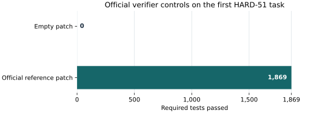

# HarnessTwin Hard preflight report

26 November 2026 · Himanshu Kumar

**The official HARD-51 verifier reproduced its expected controls in the cloud. No GMI inference ran because the runner had no API credential.** The control outcome measures the verifier, and the benchmark result files contain zero agent observations.

## Cloud verifier evidence

| Control | Required tests passed | Official reward | Verifier wall time |
| --- | ---: | ---: | ---: |
| Empty patch | 0 / 1,869 | 0 | 11.66 s |
| Official reference patch | 1,869 / 1,869 | 1 | 9.15 s |

Both controls used fresh official qutebrowser containers at repository commit `fce306d5f184f185b660f35ec2808b6745d57520`. The official Docker image digest was `sha256:b35c588560c0041a3d0989696ade4a1ae1e5123e3e07b27240fb918d16237747`. The runner first exposed two evidence-handling issues, one writing files under the official image's non-root user and the other uploading verifier files created with restrictive permissions. The final control run verified both outcomes and uploaded the logs successfully.

[Successful control job and raw evidence](https://github.com/himanshu748/harnesstwin-hard/actions/runs/45702666035)

## Pilot design

The pilot pairs Pi, OpenCode, and mini-SWE-agent on Qt key handling and Open Library search indexing. Both tasks are in the official HARD-51 list at dataset revision `66f92766bba642462d4bbe5479e83f91f9211862`. The six-run design uses one attempt per task and harness. Every attempt starts from the official task image, runs without external network access, and sends model traffic through a restricted local relay. The fresh verifier receives only the candidate patch and the official tests. The model, input task, time budget, token cap, image and task resource limits are controlled. Harness prompts, context handling and tool execution are part of the treatment.

The pilot uses 19 minutes per agent, shorter than the official 50-minute locked evaluation. The selected ten-task extension covers two repositories. Report pass@1 as the observed first-attempt resolution rate and estimate paired differences by task. If repeats are affordable, preserve attempt IDs and bootstrap tasks as clusters. With only two tasks, interval estimates would be descriptive.

[Official benchmark and locked protocol](https://github.com/scaleapi/SWE-bench_Pro-os/tree/main/v2)

## Costs and blocked runs

| Item | Actual | Planned upper estimate |
| --- | ---: | ---: |
| GMI Cloud inference | $0.00 | $2.70 for one task across three harnesses, $5.40 for the full pilot |
| GitHub Actions standard Linux compute in the public repository | $0.00 | $0.00 |
| GMI Agentbox, Modal, Hugging Face Jobs, Vercel | $0.00 for this execution | Unused |

The estimate reserves $0.90 per attempt using GMI's published GLM-5.3 Flash list rates of $0.15 per million input tokens and $0.50 per million output tokens. It excludes any promotional discount and assumes the pinned endpoint honors its context and completion caps. The GMI console session authenticated through Google. The account-specific `GET /v1/models` workflow stopped before making the request because `GMI_API_KEY` was absent. The exact serving ID has yet to be verified from that endpoint. Repeat or broader runs require a fresh cost reconciliation.

[Inventory job](https://github.com/himanshu748/harnesstwin-hard/actions/runs/45702756693) · [GitHub standard runner pricing](https://docs.github.com/en/actions/how-tos/write-workflows/choose-where-workflows-run/choose-the-runner-for-a-job) · [GMI list prices](https://www.gmicloud.ai/en/blog/chinese-language-agents-glm-5-3-managed-environment)

## Upstream contribution

[Models.dev PR #14632](https://github.com/anomalyco/models.dev/pull/14632) corrects the published list prices for the existing `deepseek-ai/DeepSeek-V4-Flash` GMI entry. It changes input from $0.112 to $0.14, cached input from $0.022 to $0.028, and output from $0.224 to $0.28 per million tokens. OpenCode consumes this catalog. The existing runtime model discovery PR [OpenCode #60673](https://github.com/anomalyco/opencode/pull/60673) and catalog additions PR [Models.dev #12148](https://github.com/anomalyco/models.dev/pull/12148) were open at the time of review.

`bun validate` passed. The v1 check reported exactly the three intended pricing changes for one model. The core suite had 976 passes and one LLM Gateway test failure, reproduced on the clean upstream revision. The upstream CI ran catalog validation and SDK tests successfully. Maintainer approval of the v1 data change is pending, and GMI Cloud reward eligibility is unconfirmed.

[Upstream validation job](https://github.com/anomalyco/models.dev/actions/runs/45703110571)
